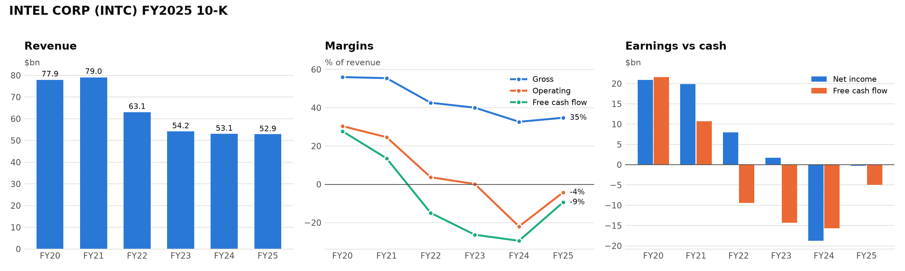
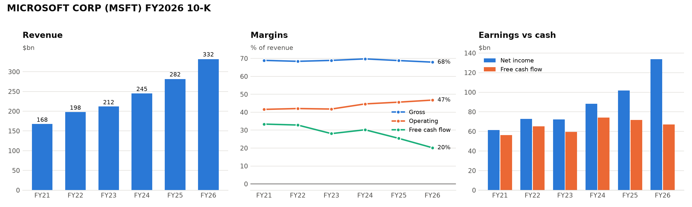

# filing-analyst


A first-pass 10-K screen, the kind an analyst at a hedge fund or PE shop does before deciding whether a company is worth a real look. It pulls the filing and XBRL financials straight from SEC EDGAR, runs accounting red-flag screens, diffs this year's risk factors against last year's, and then has Claude write a screening memo in which every factual claim is footnoted to the passage it came from.

The deterministic parts (data, screens, risk factor diff) run without an API key and are fully unit tested. Claude is used only for the step that needs judgment: deciding which flags are explained by the filing and which are open questions.



## What it does

| Step | How | Needs API key |
|---|---|---|
| Find and download the 10-K | SEC EDGAR submissions API, cached on disk, rate limited | no |
| Split the filing into Items (1, 1A, 7, 7A, 8, 9A...) | HTML to text, then a heading matcher that ignores the table of contents and page headers | no |
| Five years of standardized financials | XBRL company facts, with tag fallbacks and restatement handling | no |
| Accounting screens | A dozen rules (receivables vs revenue, cash conversion, accruals, leverage, dilution...) plus text screens for going concern, material weakness and restatement | no |
| Risk factor diff | Paragraph matching on word 3-grams against the prior year's 10-K | no |
| Screening memo / Q&A | Claude (`claude-opus-5-5`) with document citations | yes |

## Quick start

```bash
git clone https://github.com/bmazzoldi/filing-analyst.git
cd filing-analyst
pip install -e ".[dev]"

export SEC_USER_AGENT="Your Name you@example.com"   # the SEC requires this
filing-analyst screen INTC --chart intc.png
```

```
Screens
  [medium] Receivables growing faster than revenue
           FY2025: receivables 10.4% vs revenue -0.5%; DSO 24 -> 27 days
  [medium] Elevated leverage
           FY2025: net debt / EBITDA 3.8x
  [low   ] Diluted share count rising
           FY2025: diluted shares 5.8% YoY
  [medium] Revenue down two years running
           Revenue growth -2.1%, then -0.5%

Risk factors vs FY2024: 32 new, 32 removed, 18 substantially rewritten, 61 carried over
  + If we are unable to secure a significant external foundry customer for Intel 14A, our next [...]
  + If we were to pause or discontinue the design, development and manufacturing of Intel 14A and [...]
```

The full output, including the five-year financial table, is in [`examples/INTC_screen.txt`](examples/INTC_screen.txt) and [`examples/MSFT_screen.txt`](examples/MSFT_screen.txt).

## The memo

```bash
export ANTHROPIC_API_KEY=...
filing-analyst memo MSFT --out examples/
```

Claude receives the financial table, the screen results, the risk factor diff and the relevant 10-K sections. Each one is a separate document with citations enabled. The memo always uses the same structure: bottom line, how the business makes money, what changed, quality of earnings, balance sheet, risk factor changes, bull/bear case and questions for management. Citations are rendered as Markdown footnotes, so every number and claim can be traced back to the filing text.

See [`examples/MSFT_FY2026.md`](examples/MSFT_FY2026.md) for a full example.


The prompt is in [`src/filing_analyst/prompts/memo_system.md`](src/filing_analyst/prompts/memo_system.md). A few choices are deliberate:

- **Screens are framed as questions, not conclusions.** Microsoft's FY2026 cash conversion screen fires, with FCF at 0.50x net income. The cause is capex rising to 35% of revenue for the AI data center build-out. The memo is expected to say whether the filing explains a flag rather than treat it as a red flag.
- **There is no recommendation or price target.** This is a screening tool, and the prompt forbids investment conclusions.
- **Only the documents are used.** The model is told not to bring in outside knowledge about the company, so the output reflects what the filing actually says.

You can also ask one-off questions. The filing prefix is prompt-cached, so follow-ups are cheap:

```bash
filing-analyst ask MSFT "What does management say about the useful life of servers and network equipment?"
```

A memo typically costs between $0.25 and $1 in API usage, depending on filing length.

## Risk factor diffs



Most of a risk factor section is boilerplate carried forward from the year before. The new paragraphs are where the information is. For Microsoft's FY2026 10-K, the paragraphs flagged as new are about AI infrastructure economics:

> Demand for cloud-based and AI products and services is evolving and difficult to forecast. Overestimation of demand or misalignment of capacity investments may result in underutilization of infrastructure...

For Intel, the new paragraphs cover the possibility of pausing Intel 14A if no external foundry customer signs up. `filing-analyst riskdiff INTC` prints every added and removed paragraph in full; see [`examples/INTC_riskdiff.txt`](examples/INTC_riskdiff.txt).

Paragraphs are matched with Jaccard similarity on word 3-grams:
- below 0.25 is new (or removed)
- 0.25 to 0.70 is rewritten
- above 0.70 is carried over

Comparing 3-grams makes the match robust to routine edits, like a year or a headcount changing.

## Parsing notes

Getting clean sections out of 10-Ks was the hardest part. Filers repeat "Item 1A" in the table of contents, in running page headers and in cross-references. Some, like Intel, drop Item numbers from the body entirely. The splitter in [`sections.py`](src/filing_analyst/sections.py) handles this in three steps:

1. It only accepts a heading when the Item number is followed by that Item's expected title (or, for bare titles, a short line that is the title).
2. It drops page furniture such as running headers and page numbers.
3. For each Item, it keeps the candidate that produces the longest section.

It currently finds Item 1A and Item 7 in all eight filers I tested: MSFT, INTC, BA, COST, NVDA, JPM, PLTR and F.

The XBRL layer in [`financials.py`](src/filing_analyst/financials.py) handles three problems:
- **Tag switching**: companies move between `SalesRevenueNet`, `Revenues` and `RevenueFromContractWithCustomer...`
- **Restatements**: the latest filed value for each period wins.
- **Mixed periods**: only annual values from 10-K filings are kept, so quarterly and year-to-date values are excluded.

## Tests

```bash
pytest -q
```

The tests run offline against synthetic fixtures:
- a fake 10-K with a table of contents, page headers and cross-references
- XBRL facts with a tag switch, a restatement and a stray quarterly value
- financial profiles built to trip each screen
- risk factor sections with known additions and removals
- a mocked Claude client that checks the request shape (model, adaptive thinking, citations, refusal fallback) and how citations render into footnotes

## Layout

```
src/filing_analyst/
  edgar.py        SEC client: ticker -> CIK, filings list, documents, company facts
  sections.py     HTML -> text, Item splitter, risk factor paragraphs
  financials.py   standardized annual financials and ratios from XBRL
  flags.py        accounting and text screens
  riskdiff.py     year-over-year risk factor comparison
  context.py      assembles everything for one filing; text renderings
  memo.py         Claude memo and Q&A with citations
  charts.py       overview chart
  cli.py          `filing-analyst` command
  prompts/        system prompt for the memo
```

## Limitations

- XBRL coverage varies by filer. Banks and insurers don't report gross profit or inventory, so some screens don't apply to them.
- `total_debt` comes from the long-term debt tags plus commercial paper and short-term borrowings, and excludes leases. It is good enough for screening, not for a credit model.
- The section splitter is heuristic. A filer with an unusual layout can produce a wrong boundary. Intel's Item 9A, for example, runs long.
- Screens look at the latest fiscal year only, so a one-year blip and a three-year trend get the same flag.

Not investment advice. Output is a starting point for reading the filing, not a substitute for it.
